# Kobo 電子書更新檢查器

**Other Languages:** [English](README.md)

[][greasyfork]
[](LICENSE)
[][greasyfork-stats]
[][workflow-nightly]


![Preact](https://img.shields.io/badge/preact-673ab8?style=flat-square&logo=data%3Aimage%2Fsvg%2Bxml%3Bbase64%2CPHN2ZyB4bWxucz0iaHR0cDovL3d3dy53My5vcmcvMjAwMC9zdmciIGZpbGw9IiNmZmYiIHZpZXdCb3g9IjAgMCAyNCAyNCI%2BPHBhdGggZD0iTTEyIDEwLjRhMS42IDEuNiAwIDAgMC0xLjYgMS42IDEuNiAxLjYgMCAwIDAgMS42IDEuNiAxLjYgMS42IDAgMCAwIDEuNi0xLjYgMS42IDEuNiAwIDAgMC0xLjYtMS42bTUuNS00LjNoLjZsLjUuMi4zLjIuMi40djFsLS4yLjgtLjUgMS0uOCAxLjItLjUuNS0uNy0uNy0yLTEuOC0uMi4zLjItLjMtLjUuNiAyIDEuOC43LjctLjMuMy0uMy4zLjYuNi4zLS40LjItLjIuMi4yIDEgMS4zLjUgMSAuMy44VjE3bC0uMS40LS4zLjItLjQuMi0uNi4xaC0uOHEtLjYgMC0xLS4zbC0xLjUtLjUtMS43LS44IDEuNy0xLjItLjItLjMuMi4zLS41LS42LTIuMSAxLjUtMS45IDEtMS40LjUtMS4xLjMtLjkuMWgtLjZsLS41LS4yLS4zLS4yLS4yLS40di0xbC4yLS44LjUtMUw3IDEyLjZsLjcuNyAyIDEuOC41LS42LTItMS43LS43LS44LjMtLjMuMy0uMy0uNS0uNi0uNC40LS4yLjItLjItLjJMNS4yIDkgNSA4LjFWN2wuMS0uNC4zLS4yLjQtLjIuNi0uMWguOGwxIC4zIDEuNS41IDEuNy44TDkuNiA5bC41LjZhMjMgMjMgMCAwIDEgNS40LTNsMS4xLS4zem0wLS44LTEgLjEtMS4zLjQtMS41LjYtMS43LjlhMTUgMTUgMCAwIDAtMy42LTEuN2wtMi4xLS4zLS44LjEtLjYuM2EyIDIgMCAwIDAtLjggMXYuOGwuMS44LjMgMSAuNyAxIDEgMS40LjIuM0w1IDE0bC0uNiAxLS4zIDF2LjdsLjEuN2EyIDIgMCAwIDAgLjggMWwuNy4yaDEuOGwxLjItLjNhMTQgMTQgMCAwIDAgMy4zLTEuNmwuNC4yIDEuNyAxIDEuNS41IDEuMi4yaDEuN2wuNi0uM2EyIDIgMCAwIDAgLjgtMXYtLjhsLS4xLS44LS4zLTFhMTAgMTAgMCAwIDAtMS42LTIuNGwtLjMtLjMgMS40LTIgLjYtMSAuMy0xdi0uN2wtLjEtLjdhMiAyIDAgMCAwLS44LTFsLS43LS4yek0xMiAwbDEwLjQgNnYxMkwxMiAyNCAxLjYgMThWNloiLz48L3N2Zz4%3D)

這是一款用來檢查 Kobo 電子書是否有更新的 UserScript。


## 安裝

1. 安裝支援的 UserScript 管理器（[Violentmonkey][violentmonkey] 或 [Tampermonkey][tampermonkey]）。**本 UserScript 不支援 Greasemonkey**。
1. 授予 UserScript 管理器執行 UserScript 的權限。（[設定指南][tampermonkey-permissions]）
1. 從 [Greasy Fork][greasyfork] 或 [GitHub Releases][releases] 安裝此 UserScript。


## 使用方式

若要檢查 Kobo 書庫中的電子書是否有更新，請先前往書庫頁面。您可以選擇檢查[單本書籍](#檢查單本書籍)、[目前頁面](#檢查目前頁面)，或[整個書庫](#檢查整個書庫)。

若書籍的最終狀態為「最新」、「有更新」、「預覽」或「預購」，檢查結果便會快取。在這些情況下，為了節省流量，不會再次檢查該書籍。

> [!NOTE]
>
> 快取會保留至頁面重新載入或離開書庫為止。


### 檢查單本書籍

1. 點選書庫項目上的 <kbd><samp>⋯</samp></kbd> 操作按鈕。
1. 在選單中點選 <kbd><samp>檢查更新</samp></kbd>。
1. 查看即時更新的[書籍狀態指示器](#單本書籍或目前頁面的狀態指示器)。


### 檢查目前頁面

1. 點選頁面頂端的 <kbd><samp>為本頁檢查更新</samp></kbd> 按鈕。
1. 查看即時更新的[書籍狀態指示器](#單本書籍或目前頁面的狀態指示器)，並在檢查完成後查看[結果摘要對話框](#目前頁面或整個書庫的結果摘要)。

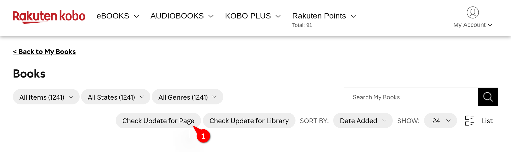


### 檢查整個書庫

1. 點選頁面頂端的 <kbd><samp>為書庫檢查更新</samp></kbd> 按鈕。
1. 點選 <kbd><samp>開始檢查</samp></kbd> 按鈕，確認要檢查整個書庫。
1. 如果先前已檢查過書庫，系統會詢問您是否要重新載入快取的書庫。若篩選條件（例如搜尋關鍵字、類型或項目種類）有所變更，請點選 <kbd><samp>重新載入書庫</samp></kbd>。否則，您可以點選 <kbd><samp>略過重新載入</samp></kbd>，節省重新載入書庫所需的時間。
1. 接著會顯示進度對話框，供您查看檢查進度。您可以隨時取消檢查。
1. 檢查完成後，查看[結果摘要對話框](#目前頁面或整個書庫的結果摘要)。

> [!NOTE]
>
> 快取會保留至頁面重新載入或離開書庫為止。

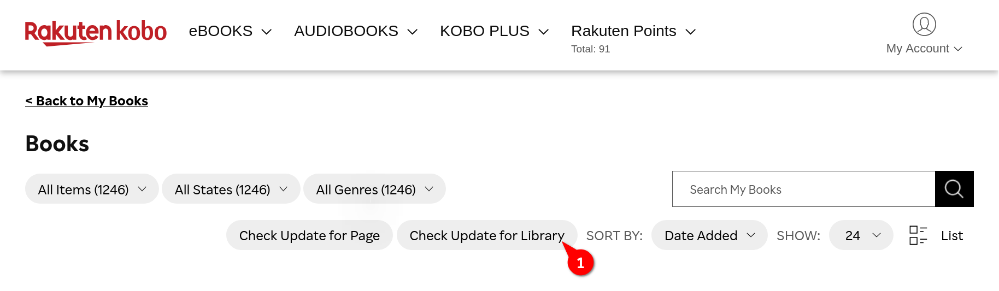

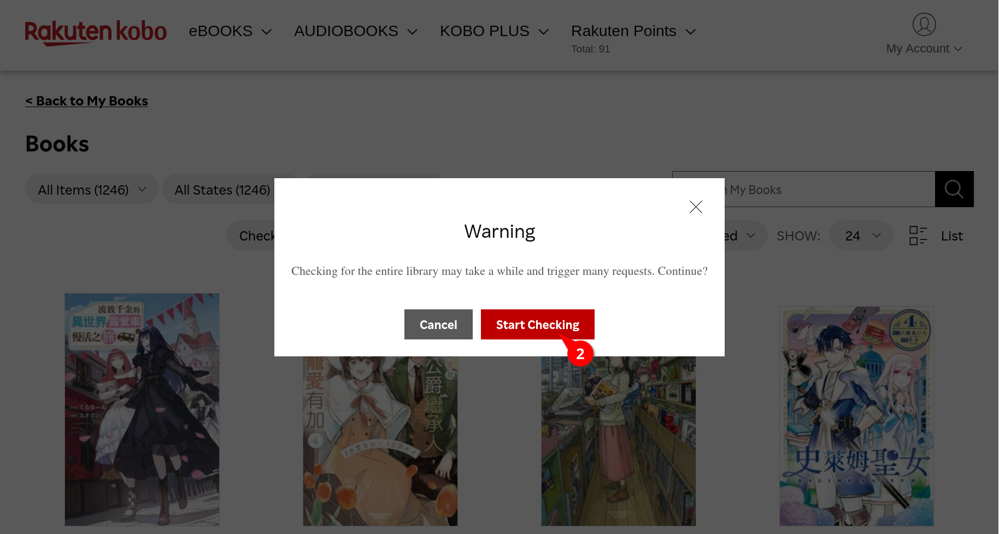

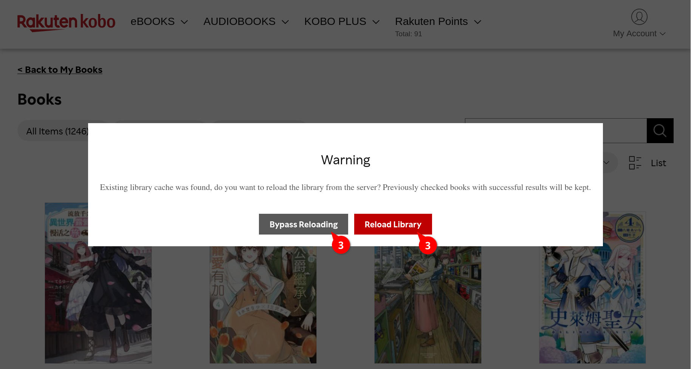

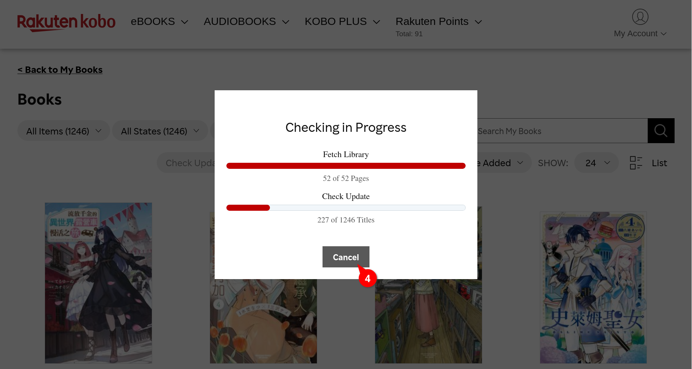


### 單本書籍或目前頁面的狀態指示器

狀態指示器會即時顯示特定書庫項目的目前狀態。若狀態為「檢查失敗」，點選指示器即可查看詳細錯誤訊息。


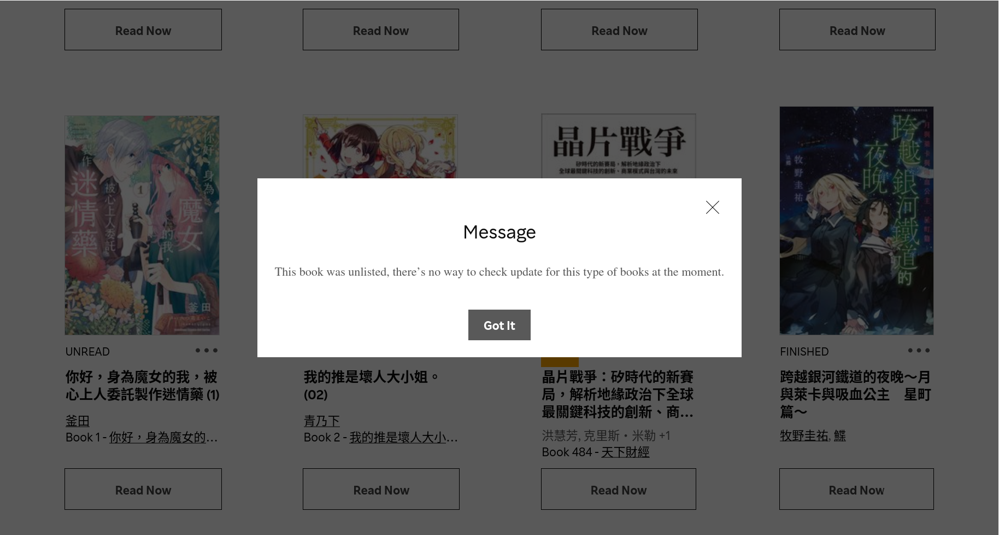

#### 附錄：所有可能的狀態

<table>
	<tr>
		<th scope="col" width="12.5%">等待中</th>
		<th scope="col" width="12.5%">檢查中</th>
		<th scope="col" width="12.5%">最新</th>
		<th scope="col" width="12.5%">有更新</th>
		<th scope="col" width="12.5%">預覽</th>
		<th scope="col" width="12.5%">預購</th>
		<th scope="col" width="12.5%">已略過</th>
		<th scope="col" width="12.5%">檢查失敗</th>
	</tr>
	<tr>
		<td>
			
		</td>
		<td>
			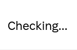
		</td>
		<td>
			
		</td>
		<td>
			
		</td>
		<td>
			
		</td>
		<td>
			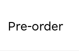
		</td>
		<td>
			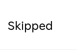
		</td>
		<td>
			
		</td>
	</tr>
</table>


### 目前頁面或整個書庫的結果摘要

在結果摘要對話框中，您可以：

1. 切換各個狀態區段，以查看摘要；或
1. 將[報告](#目前頁面或整個書庫的報告)儲存到本機，以供日後參考。

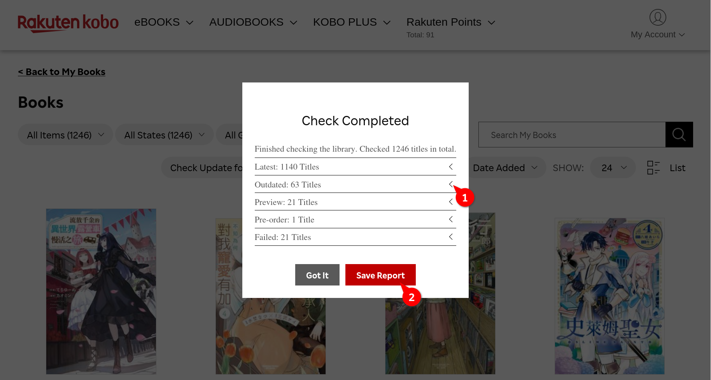

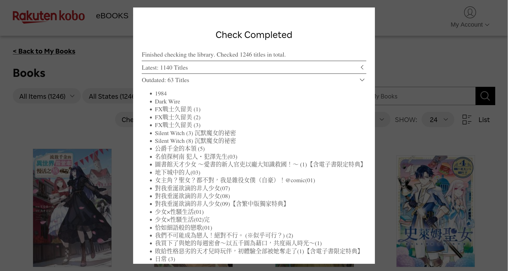


### 目前頁面或整個書庫的報告

報告是一份 HTML 文件，會以符合地區語言習慣的方式排序所有已檢查的書籍，並依書籍狀態分組。您可以根據報告聯絡客服，要求更新有新版本的書籍。

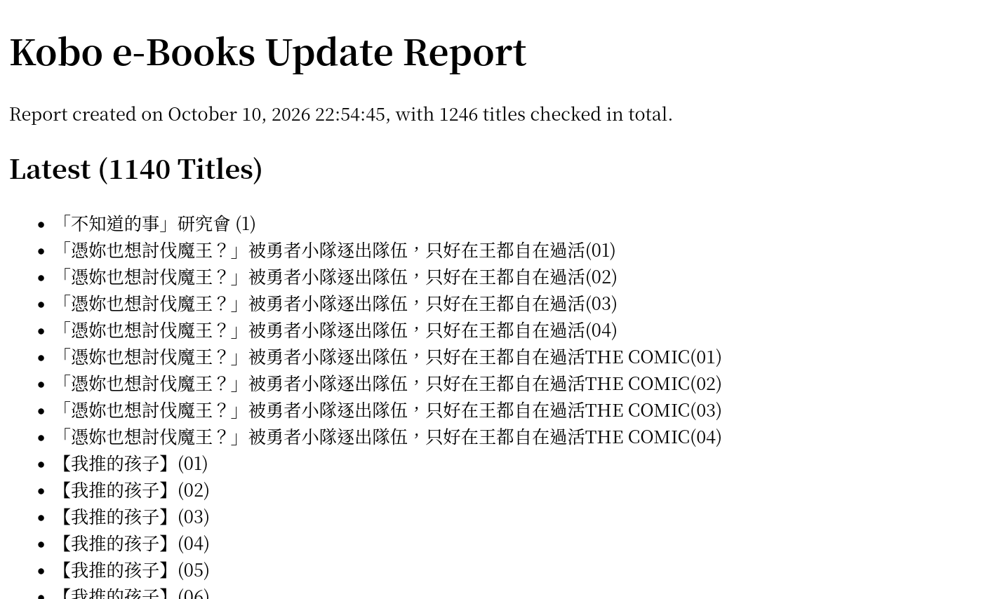


## 問題回報

發現問題了嗎？請先查看[現有問題](https://github.com/JasonHK/kobo-ebooks-update-checker/issues)，再[提交錯誤回報](https://github.com/JasonHK/kobo-ebooks-update-checker/issues/new)，並提供重現步驟、預期與實際結果，以及瀏覽器和 UserScript 管理器的相關資訊。請勿提供帳戶憑證或其他敏感資訊。若要回報安全性漏洞，請依照 [SECURITY.md](SECURITY.md) 中的流程辦理。


## 開發

開發環境需要 Node.js 24.x 和 pnpm 12.x。

```sh
pnpm install --frozen-lockfile
pnpm run dev
pnpm run build
```

建置程序會重新產生本地化輔助程式、檢查 TypeScript，並打包 UserScript。若要翻譯介面，請編輯 [src/locales](src/locales) 下的語系來源字典，然後執行 `pnpm run locales --no-watch`。請勿直接編輯產生的本地化檔案。環境設定、翻譯與貢獻方式請參閱 [CONTRIBUTING.md](CONTRIBUTING.md)。


## 安全注意事項

UserScript 會在您的瀏覽器中執行，並可使用 UserScript 管理器授予的權限。請只從官方儲存庫或您已檢視過的版本安裝此腳本，避免使用來路不明的修改版本。

儲存報告時會使用 `GM.download`。若下載失敗，`GM.openInTab` 會在新分頁中開啟報告。只有在您點選 <kbd><samp>儲存報告</samp></kbd> 按鈕後，才會啟動此流程。此腳本也會從 [unpkg.com](https://unpkg.com/) 載入相依套件。

此腳本會使用您現有的登入工作階段向 Kobo 擷取書庫頁面；擷取產品頁面時則不會帶上工作階段憑證。報告會在本機產生，不會傳送至本專案。

安全政策及漏洞回報流程請參閱 [SECURITY.md](SECURITY.md)。


## 授權條款

本專案採用 GNU General Public License v3.0 授權。完整授權條款請參閱 [LICENSE](LICENSE)。


[releases]: https://github.com/JasonHK/kobo-ebooks-update-checker/releases/latest
[workflow-nightly]: https://github.com/JasonHK/kobo-ebooks-update-checker/actions/workflows/nightly.yml
[greasyfork]: https://greasyfork.org/scripts/482410
[greasyfork-stats]: https://greasyfork.org/scripts/482410/stats
[violentmonkey]: https://violentmonkey.github.io/
[tampermonkey]: https://www.tampermonkey.net/
[tampermonkey-permissions]: https://www.tampermonkey.net/faq.php?q=Q209
